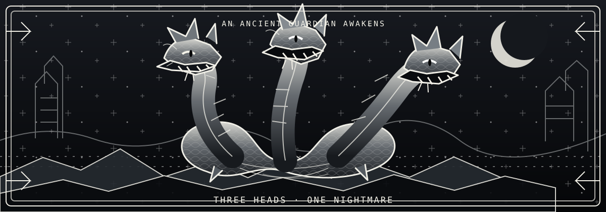

### ✦ SOFTWARE DEVELOPER · AI · GAME DEVELOPMENT · EMBEDDED SYSTEMS ✦

*Exploring the space where software, intelligent systems, interactive worlds and engineering meet.*

---

## 〔 ABOUT THE DEVELOPER 〕

I'm **Eduardo Marek**. My public repositories are a collection of practical experiments, engineering studies and software projects.

I enjoy moving between different layers of a problem: understanding the algorithm, modeling the system, implementing the software, connecting it to hardware, and shaping the experience people interact with.

My work and studies currently span:

- **Software engineering** — C++, Python, Java and web technologies.
- **Artificial intelligence** — machine learning, neural networks and evolutionary algorithms.
- **Game development** — gameplay systems, simulations and fantasy-world design.
- **Embedded systems** — ESP32, microcontrollers and hardware integration.
- **Control engineering** — PID, fuzzy logic and experimental automation.

## 〔 CHARACTER ATTRIBUTES 〕

| Attribute | Focus |
|:--|:--|
| ⚔️ Software | Algorithms, state machines, simulations |
| ✧ Intelligence | Machine learning, neural networks, genetic algorithms |
| 🛡️ Engineering | Embedded systems, electronics, control |
| 🏰 Game systems | RPG mechanics, multiplayer concepts, interactive prototypes |
| ◈ Tools | C / C++, Python, Java, JavaScript, HTML, CSS, GDScript, Ladder, MySQL, ESP32, Arduino, ENet, SDL2 |

## 〔 QUEST BOARD · FEATURED PROJECTS 〕

<b>✧ Intelligent systems & control</b>

| Project | Description | Technologies |
|:--|:--|:--|
| [GA_FUZZY_CONTROLLER](https://github.com/Edumarek123/GA_FUZZY_CONTROLLER) | Fuzzy control with genetic-algorithm tuning for an experimental motor setup. | C++ · Embedded |
| [ENeuralNetworkLib](https://github.com/Edumarek123/ENeuralNetworkLib) | Experimental C++ feedforward neural-network library with matrix operations, backpropagation and desktop/Arduino support paths. | C++ · Neural networks · Arduino |
| [FUZZY_Controller](https://github.com/Edumarek123/FUZZY_Controller) | Fuzzy-logic controller targeting the ESP32 platform. | C++ · ESP32 |
| [ML_LUNG_CANCER](https://github.com/Edumarek123/ML_LUNG_CANCER) | Educational tabular-classification experiment. | Python · scikit-learn |

<b>🏰 Game development & simulations</b>

| Project | Description | Technologies |
|:--|:--|:--|
| [TileFantasy](https://github.com/Edumarek123/TileFantasy) | Fantasy MMO concept and project exploring world, progression and game-system design. | Game development |
| [HeroTower](https://github.com/Edumarek123/HeroTower) | Fantasy multiplayer game project with planned PvP and PvE modes. | Godot |
| [Snake](https://github.com/Edumarek123/Snake) | Snake simulation exploring neural networks and genetic algorithms. | C++ · SDL2 |
| [Barcos_g](https://github.com/Edumarek123/Barcos_g) | Browser-based naval-map prototype. | Web |

<b>⚙️ Software foundations & hardware projects</b>

| Project | Description | Technologies |
|:--|:--|:--|
| [FSM](https://github.com/Edumarek123/FSM) | Finite state machine implementation. | C++ |
| [AlgoritimosOrdenacao](https://github.com/Edumarek123/AlgoritimosOrdenacao) | Sorting algorithm experiments and visualization. | C++ · SDL2 |
| [Chess_Clock](https://github.com/Edumarek123/Chess_Clock) | DIY chess-clock electronics and firmware project. | AVR · Electronics |
| [SistemaMultiAgentes_bloquinhos](https://github.com/Edumarek123/SistemaMultiAgentes_bloquinhos) | Multi-agent blocks simulation. | Java |

## 〔 WORKSHOP · TECHNOLOGIES 〕

## 〔 CURRENTLY EXPLORING 〕

- Designing maintainable software and clear system architectures.
- Building interactive game systems and prototypes.
- Applying AI techniques to simulations and control problems.
- Connecting software with embedded hardware.

## 〔 GUILD HALL · LET'S CONNECT 〕

Interested in a project, have a question, or want to exchange ideas? The best place to start is the repository related to the topic.

[**Explore all repositories →**](https://github.com/Edumarek123?tab=repositories)

*Thanks for visiting my corner of the GitHub realm.*

`[ END OF TRANSMISSION ]`

---

Project descriptions reflect the scope documented in each repository. Some entries are experiments or works in progress; planned features should not be interpreted as completed implementations.
